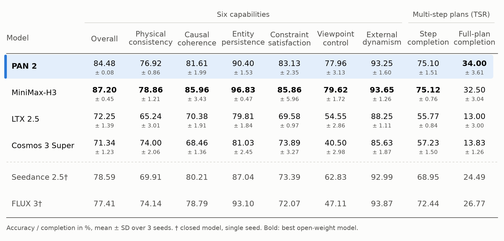
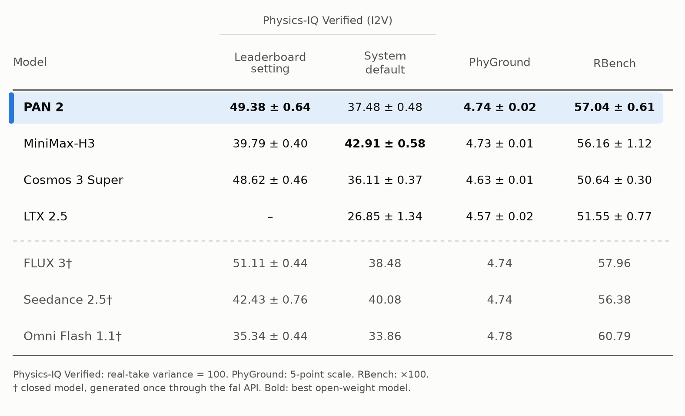
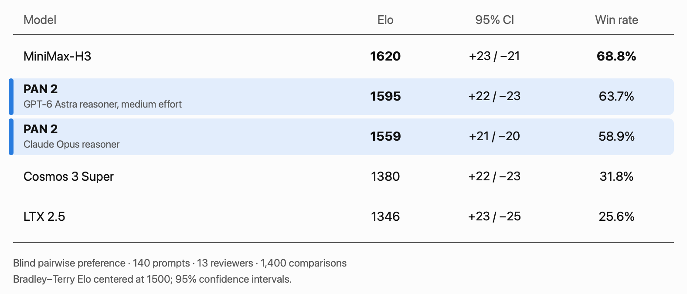

<div align="center">
  <picture>
    <source media="(prefers-color-scheme: dark)" srcset="https://huggingface.co/IFM/PAN2/resolve/main/assets/pan2-logo-dark.png">
    
  </picture>
</div>

<p align="center">
  <a href="https://github.com/ifm-ai/PAN2" target="_blank"></a>
  <a href="https://huggingface.co/IFM/PAN2" target="_blank"></a>
  <a href="https://huggingface.co/docs/diffusers/main/en/api/pipelines/pan2" target="_blank"></a>
  <a href="https://recipes.vllm.ai/IFM/PAN2" target="_blank"></a>
  <a href="https://github.com/ifm-ai/PAN2/blob/main/README.md" target="_blank"></a>
  <a href="https://github.com/ifm-ai/PAN2/blob/main/LICENSE" target="_blank"></a>
</p>

# PAN 2

Developed by the Institute of Foundation Models (IFM) at MBZUAI.

<video src="https://huggingface.co/IFM/PAN2/resolve/main/assets/video.mp4" width="100%" autoplay loop muted playsinline></video>

## Overview

PAN 2 is a general-purpose world model: it simulates how the world will change in response to actions. Given a current observation (an optional image plus text) and actions described in text, it simulates the outcome as a video of up to 20 seconds. This supports *simulative reasoning*: an agent can imagine the outcomes of its candidate actions before choosing among them, by simulating each plan with PAN 2 and acting on the one whose simulated outcome is best.

PAN 2 follows the Generative Latent Prediction (GLP) architecture formalized in [Critique of World Models](https://arxiv.org/abs/2507.05169) and couples **conceptual reasoning** by a large language model with **perceptual reasoning** by a latent diffusion model. The language model, the **conceptual reasoning backbone**, reasons over the observation and the requested actions and writes the next world state as a structured, time-grounded description of events, timed actions bound to actors, and camera motion. The frozen text encoder maps the structured description to the conditioning features used by the diffusion model. The 29B-parameter MMDiT, the **perceptual reasoning backbone**, trained from scratch on hundreds of millions of videos annotated in the same format, predicts the perceptual detail that the description leaves open: the video latents that realize the state, conditioned on it and on the VAE latent of the starting image. The Wan 2.2 VAE decoder renders the predicted latents as the next observation, so every prediction can be seen and checked against real footage.

## Checkpoints

PAN 2's latent diffusion model is released as a single checkpoint that serves both tasks. The frozen text encoder (Qwen3.5-9B) and VAE (Wan 2.2) are downloaded from their own repositories.

|Checkpoint|Supported Tasks|Input Conditions|Output|Precision|
|---|---|---|---|---|
|PAN 2 diffusion backbone (`IFM/PAN2`)|Text-to-video (`t2v`), Image-to-video (`i2v`)|Structured world-state caption; optional first frame|Video via the VAE decoder, 704x1248 at 24 fps, up to 20 s|BF16|

## Usage

PAN 2 is also supported in [Diffusers](https://huggingface.co/docs/diffusers/main/en/api/pipelines/pan2) and [vLLM](https://recipes.vllm.ai/IFM/PAN2); the instructions below use this repository's `generate.py`.

### Local Deployment of the PAN 2 Simulator

The released perceptual backbone weights are in the diffusers layout (`PAN2Transformer3DModel`). Download them and convert them once for this repository's `generate.py`:

```bash
hf download IFM/PAN2 --include "transformer/*" --local-dir /path/to/PAN2
python scripts/convert_checkpoint.py to-native \
    --input /path/to/PAN2/transformer --output <DIR>/transformer
```

Then pass `<DIR>/transformer` as `CKPT_PATH` below.

**Environment** (see [docs/environment.md](https://github.com/ifm-ai/PAN2/blob/main/docs/environment.md)):

```bash
conda create -n pan python=3.14 -y && conda activate pan
pip install torch==2.12.1 torchvision==0.27.1 --index-url https://download.pytorch.org/whl/cu132
pip install --pre "flash-attn-4[cu13]==4.0.0b29" --no-build-isolation
pip install "quack-kernels[cu13]==0.6.4"
pip install -r requirements.txt
```

**Frozen components** (text encoder and VAE, fetched from the Hugging Face cache at `HF_HOME`):

```bash
export HF_HOME=YOUR_HF_PATH
hf download Qwen/Qwen3.5-9B
hf download Wan-AI/Wan2.2-TI2V-5B-Diffusers
```

**Checkpoint.** `CKPT_PATH` is a training `checkpoint-N/transformer` directory (DCP), a `model_state.pt`, or a directory of `*.safetensors`. The architecture is read from `config/sft_29B_720p.yaml`; no model root is needed.

**Generate** (single node, one `generate.py` worker per GPU; each worker holds the full 29B diffusion model and takes every N-th prompt):

```bash
bash inference/inference.sh <CKPT_PATH> <OUTPUT_DIR> [PROMPTS_JSON]   # or sbatch, same arguments
```

`PROMPTS_JSON` defaults to `inference/prompts/examples.json` (one `t2v` and one `i2v` record with structured negatives and a reference image). Any entry with an `image_path` (or `type: i2v`) runs as image-to-video. Videos land in `<OUTPUT_DIR>/{t2v,i2v}/` next to a `*_config.json`; a rerun into the same directory skips finished clips.

Default sampler:

| Control | Value |
|---|---|
| Steps / flow shift | 50 / 9 |
| Classifier-free guidance | 2.5 on every step |
| Resolution / frame rate | 704 x 1248 at 24 fps |
| Frames | 241 (about 10 s) for entries without a duration; up to 481 (20 s) |
| Seed | 123 |
| Precision | bf16 transformer |
| I2V | temporal latent 0 uses the positive prediction without guidance |

Override any default through environment variables (`NUM_STEPS`, `FLOW_SHIFT`, `GUIDANCE_SCALE`, `VIDEO_LENGTH`, `SEED`, `NUM_GPUS`, ...) or pass extra `generate.py` flags in `EXTRA_ARGS` (CFG windows, skip-layer guidance, timestep schedules). See [docs/inference.md](https://github.com/ifm-ai/PAN2/blob/main/docs/inference.md).

### Full PAN 2 Workflow

The full workflow runs the conceptual reasoner on a free-text prompt, then the locally deployed perceptual pipeline on its structured output.

<table>
  <thead>
    <tr><th>stage</th><th>request</th><th>result</th></tr>
  </thead>
  <tbody>
    <tr><td>Conceptual reasoner</td><td><a href="https://github.com/ifm-ai/PAN2/blob/main/inference/pan-prompt-rewriter/SKILL.md">PAN 2 Conceptual Reasoner (Prompt Rewriter) skill</a>, or <code>python inference/prompts_rewritter.py</code> with a local instruction-tuned model</td><td>The prompt JSON with a structured <code>refined_prompts</code> world-state caption added to each record</td></tr>
    <tr><td>Perceptual pipeline</td><td><code>bash inference/inference.sh &lt;CKPT_PATH&gt; &lt;OUTPUT_DIR&gt; &lt;REWRITTEN_JSON&gt;</code></td><td><code>&lt;OUTPUT_DIR&gt;/{t2v,i2v}/*.mp4</code>, each next to a <code>*_config.json</code></td></tr>
  </tbody>
</table>

See [docs/inference.md](https://github.com/ifm-ai/PAN2/blob/main/docs/inference.md#5-prompt-rewriting) for the prompt JSON format.

### Prompting Guidance

The PAN 2 perceptual backbone is conditioned on structured world-state captions, so prompts work best in that format. Free-text prompts should be rewritten by a conceptual reasoner before generation.

- [PAN 2 Conceptual Reasoner skill](https://github.com/ifm-ai/PAN2/blob/main/inference/pan-prompt-rewriter/SKILL.md): a Codex / Claude Code agent skill carrying the caption policy ([system_prompt.md](https://github.com/ifm-ai/PAN2/blob/main/inference/pan-prompt-rewriter/system_prompt.md)), the fixed negative prompt, and a validator for the text-encoder token budget (soft limit 1,480, hard capacity 1,536 tokens per caption).
- `inference/prompts_rewritter.py`: offline rewriting with a local instruction-tuned model.
- [docs/inference.md](https://github.com/ifm-ai/PAN2/blob/main/docs/inference.md#5-prompt-rewriting): prompt JSON format and rewriting.

Reasoners evaluated in the report, in order of full-plan completion: Claude Opus 5.5, GPT-6 Astra (medium effort), Kimi K3, Qwen 3.8 Flash. Any instruction-following LLM can be used.

## Headline Results

The technical report uses Kimi K3 for all studies unless stated otherwise.

### Simulation Capabilities and Multi-step Plans

Six capabilities: 300 single-action test cases (201 I2V, 99 T2V), accuracy (%). Multi-step plans: 100 egocentric everyday tasks posed as I2V and T2V (200 prompts, 456 steps), step completion (%) and full-plan completion (share of simulations with every step completed, %). Mean ± SD over 3 seeds; † single seed for closed-source models.

<p align="center">
  <picture>
    <source media="(prefers-color-scheme: dark)" srcset="https://huggingface.co/IFM/PAN2/resolve/main/assets/report/results_capabilities_dark.png">
    
  </picture>
</p>

### Public Benchmarks

Physics-IQ Verified (I2V) is normalized so that the variance between two real takes is 100 (public leaderboard setting: leaderboard entries, PAN 2 with Claude Opus 5.5 as the conceptual reasoner, mean ± SD over seeds 123–126; system default setting: each model's own default pipeline run by us). PhyGround is on a 5-point scale judged by Qwen3.8-27B. RBench is the unweighted mean over five task and four embodiment categories, multiplied by 100. † closed models generated once through the fal API.

<p align="center">
  <picture>
    <source media="(prefers-color-scheme: dark)" srcset="https://huggingface.co/IFM/PAN2/resolve/main/assets/report/results_benchmarks_dark.png">
    
  </picture>
</p>

### Human Evaluation

Blind pairwise preference on 140 prompts (90 T2V, 50 I2V) judged on action adherence, physics and world consistency by 13 reviewers over 1,400 comparisons. Elo from a Bradley–Terry fit centered at 1500, with 95% confidence intervals.

<p align="center">
  <picture>
    <source media="(prefers-color-scheme: dark)" srcset="https://huggingface.co/IFM/PAN2/resolve/main/assets/report/results_human_dark.png">
    
  </picture>
</p>

## Safety Guardrails

We strongly recommend running PAN 2 behind [`pan2-guardrail`](https://github.com/ifm-ai/pan2-guardrail), which screens the request with [Qwen3Guard-Gen-4B](https://huggingface.co/Qwen/Qwen3Guard-Gen-4B) before generation and the generated video with the [Q16](https://huggingface.co/IFM/PAN2-guardrail-Q16) frame classifier after it. Use both guards. The guardrail is distributed separately; see its repository for installation and usage.

In internal evaluations with Kimi K3 as the conceptual reasoner, the guardrail reduced the share of harmful T2V requests that yield an unsafe video from 33.9% to 1.5%, and no unsafe I2V outputs were observed. It also stopped 11.5% of benign T2V requests and 3.3% of benign I2V requests. See [`pan2-guardrail`](https://github.com/ifm-ai/pan2-guardrail) for more details.

The guardrails reduce, but do not eliminate, the risk of harmful outputs, and users remain responsible for reviewing generated content and for their use of the model.

## Intended Uses

PAN 2 is intended for research and development in world modeling and simulative reasoning, including simulating the outcomes of actions for agents and robotics, studying physical and causal reasoning in video, and generating video for evaluation, education, and creative work.

## Out-of-Scope Uses

PAN 2 should not be used to:

- create content that impersonates or depicts real, identifiable people without their consent, including deepfakes;
- create or spread misinformation, including content presented as real footage of events that did not occur;
- generate sexual content involving minors, non-consensual intimate content, or content that promotes violence, harassment or discrimination;
- infringe the intellectual property, privacy or other rights of others; or
- make decisions about people or safety-critical decisions (e.g. in medical, legal or physical control systems) without independent human review and validation.

PAN 2's simulations are predictions, not records of real events, and should not be relied on as evidence of what happened or will happen.

## Training

The shipped configs `config/pretrain_29B_720p.yaml` and `config/sft_29B_720p.yaml` define the diffusion model architecture; point their `data` paths at your own latents, see [docs/training.md](https://github.com/ifm-ai/PAN2/blob/main/docs/training.md).

## Limitations

- **Long plans fail often.** About two in three simulated plans contain at least one step that is not carried out. The quantitative study covers open-loop plans designed to succeed; how faithfully PAN 2 simulates plans that should fail is not yet measured.
- **Prompt sensitivity.** Like related models, PAN 2 is sensitive to the wording of the prompt describing the observation and action; the examples beyond the training data and the agent case studies relied on hand-refined prompts.
- **Long-horizon consistency.** Each clip is simulated from at most one starting frame plus text, so appearance drifts across clips in long interactions; a perceptual memory maintained alongside the text-based state would be needed to address this.
- **Text actions are coarse.** Text suits actions that can be stated as concepts, such as opening a drawer, but specifies dexterous ones, such as where each finger meets an object, only coarsely.
- **Shortcuts.** PAN 2 may let a simulation progress while violating physical constraints (e.g. pasta appearing in the colander before it is drained), which matters for uses that depend on the intermediate states.
- **Realistic synthetic video.** PAN 2 can generate realistic video that may be mistaken for real footage. Users should disclose that content is AI-generated where it could mislead.
- **Bias and representation.** PAN 2 was trained on large-scale video data and may reflect biases or gaps in that data, including in how people, places, and activities are depicted.

## Responsible Use

PAN 2 is released under the Apache License, Version 2.0. We ask everyone who uses PAN 2 to do so responsibly, in line with applicable laws and the out-of-scope uses described above, to run it with the recommended guardrails, and to be transparent when sharing content generated with it. Concerns about misuse, security, or intellectual property can be reported to [pan@ifm.ai](mailto:pan@ifm.ai).

## License

- PAN 2 is developed by the Institute of Foundation Models (IFM) at MBZUAI. Its own code and weights are released under the [Apache License, Version 2.0](https://github.com/ifm-ai/PAN2/blob/main/LICENSE).
- Third-party components (Wan 2.2, Qwen3.5-9B and Diffusers) are used under their own licenses; see [NOTICE](https://github.com/ifm-ai/PAN2/blob/main/NOTICE) and [THIRD_PARTY_LICENSES](https://github.com/ifm-ai/PAN2/blob/main/THIRD_PARTY_LICENSES). The Wan 2.2 and Qwen3.5-9B weights are used as released by their authors and have not been modified or fine-tuned by MBZUAI. Third-party code adapted in this repository keeps its original copyright and license header, with a notice describing MBZUAI's changes.

## Citation

```bibtex
@misc{pan2_2026,
  title        = {PAN 2},
  author       = {{PAN Team}},
  organization = {Institute of Foundation Models, Mohamed bin Zayed University of Artificial Intelligence},
  year         = {2026},
  month        = oct,
  howpublished = {\url{https://huggingface.co/IFM/PAN2}},
  url          = {https://huggingface.co/IFM/PAN2}
}
```

## Contact Us

For questions and bugs, open an issue on [GitHub](https://github.com/ifm-ai/PAN2/issues). To report misuse, security or IP concerns, email [pan@ifm.ai](mailto:pan@ifm.ai).
